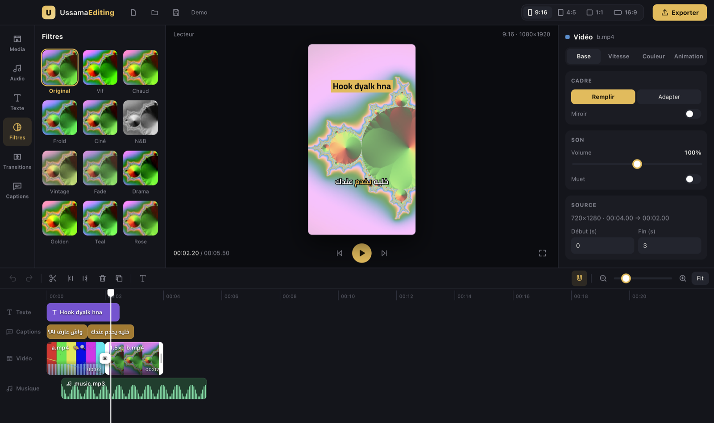

<p align="center">
  
</p>

<h1 align="center">UssamaEditing</h1>

<p align="center">
  <b>Free, open-source desktop video editor in the style of CapCut, made for Reels and TikTok.</b><br />
  9:16 by default · offline auto-captions in Darija / Arabic / French / English · animated text · transitions · no watermark.
</p>

<p align="center">
  
</p>

## Features

| | |
|---|---|
| 📱 **Formats** | 9:16 (Reels / TikTok), 4:5, 1:1, 16:9, one click. Each clip can fill (crop) or fit the frame. |
| ✂️ **Timeline** | Magnetic main track, text, captions and music tracks with thumbnails and audio waveforms. Split, delete left / right of the playhead (Q / W), duplicate, trim, reorder, snapping, undo / redo. Drag media from the library or straight from Finder. |
| 💬 **Auto-captions** | Offline transcription with Whisper, word by word, Darija and Arabic included. 4 looks: *Bold* (spoken word highlighted), *Box*, *Word by word* (pop), *Clean*. Edit any caption by hand. |
| 🅰️ **Text** | Title, hook box and subtitle presets, dragged into place right on the video. Outline, box or shadow, colours, bold, and *Pop*, *Fade* or *Slide* entrance animations. Arabic right-to-left text rendered correctly (Cairo font). |
| 🖼️ **Overlay / PiP** | Videos, images and stickers on top of the main track, on as many lanes as you need. Circle (with coloured ring), rounded or plain shape, size, rotation, opacity, drag and resize right on the video. |
| ✨ **Keyframes** | Animate an overlay's position and size: add keyframes, move the playhead, drag the overlay. |
| 🪄 **Background removal** | Remove the background behind a person in a video, offline with Apple Vision (macOS), or key out a green screen (chroma key). |
| 😀 **Stickers** | 32 colour emoji stickers with a pop entrance. Emoji typed in text are drawn with Noto Emoji. |
| 🎙️ **Voice** | Record a voice-over from the microphone, or turn text into speech with the system voices (Arabic, French, English). |
| 🔊 **Sound effects** | 30 built-in effects (whoosh, pop, ding, boom, riser, typing, glitch, cha-ching, heartbeat, applause, drumroll…), generated on your computer and level-matched, free to use. |
| 🏠 **Home** | Animated start screen: new project by format, and your recent projects (autosaved) with thumbnails. |
| 🌍 **Languages** | Interface in Darija, French or English. |
| 🧩 **Templates** | Reel hook + captions, podcast clip, product ad, tutorial, YouTube: add styled text and a caption look in one click. |
| 🎨 **Filters** | 12 colour filters (Vif, Chaud, Froid, Ciné, N&B, Vintage, Golden, Teal…) with intensity, plus brightness, contrast and saturation. |
| 🎞️ **Clips** | Speed 0.5× to 3× (audio pitch kept), slow zoom in / out (Ken Burns), mirror, fill or fit, fade in / out, freeze frame, reverse. Still images on the main track. |
| 🔀 **Transitions** | 17 transitions: fades through black / white, flash, cross-fade, slide (4 directions), wipe, circle, zoom, blur, dissolve, pixels, radial, squeeze. Overlapping ones blend the two clips like CapCut. Apply to one cut or to all. |
| 🎵 **Audio** | Clip volume and mute, music track with volume and fades. |
| ⬆️ **Export** | MP4 (H.264 + AAC) in three quality levels. What you see in the preview is what you export. |

Everything runs on your computer. Nothing is uploaded. Your project is autosaved as you work.

## Install (macOS, Apple Silicon)

Download `UssamaEditing-<version>-arm64.dmg` from the Releases page, open it and drag UssamaEditing to Applications.
The app is not signed with an Apple developer certificate yet, so the first time: right-click the app → **Open** → **Open**.

To build the installer yourself: `npm run dist` (macOS `.dmg`) or `npm run dist:win` (Windows installer).

## Run from source

Requirements: **Node.js 18+**. Works on macOS (tested) and Windows.

```bash
git clone https://github.com/oussama20011p/UssamaEditing.git
cd UssamaEditing
npm install
npm start
```

FFmpeg comes with the project (`ffmpeg-static`).

### Auto-captions setup (once)

Captions use [whisper.cpp](https://github.com/ggml-org/whisper.cpp) through its `whisper-cli` command.

```bash
brew install whisper-cpp
mkdir -p ~/.cache/whisper
curl -L -o ~/.cache/whisper/ggml-large-v3-turbo.bin https://huggingface.co/ggerganov/whisper.cpp/resolve/main/ggml-large-v3-turbo.bin
```

`ggml-large-v3-turbo.bin` (~1.6 GB) gives the best Darija. For a smaller, faster download use `ggml-base.bin` instead.
The app picks the best model it finds in `~/.cache/whisper`.

## Shortcuts

| Key | Action |
|---|---|
| Space | Play / pause |
| S or ⌘B | Split at the playhead |
| Q / W | Delete left / right of the playhead |
| ⌘D | Duplicate the selected clip |
| Home | Back to the start |
| Delete | Delete the selected clip |
| ⌘Z / ⌘⇧Z | Undo / redo |
| ← → | One frame (Shift: one second) |

## How it is built

- **Electron** window, **React** UI built with **Vite** (`src/`).
- **FFmpeg** export graph (`electron/ffmpeg.cjs`): trim, speed, framing, zoom, colour and fades per clip, then concat.
- Colour filters live in `shared/filters.json`; `shared/look.cjs` turns them into FFmpeg `eq` + `colorchannelmixer` for the export and an SVG colour matrix for the preview.
- Text and captions are written to an **ASS** subtitle script (`electron/ass.cjs`) and burned in with **libass**,
  which shapes Arabic correctly. The preview (`src/textStyle.js`) mirrors the same styles.
- Overlays are composited by FFmpeg (`overlay`, `geq` masks, `colorkey`), with keyframes turned into expressions of time (`shared/keyframes.cjs`).
- Background removal (`electron/cutout.swift` + `electron/cutout.cjs`): Apple Vision person masks merged with the frames into a transparent VP9 WebM.
- Captions (`electron/whisper.cjs`): the main track's audio is extracted at 16 kHz and transcribed by `whisper-cli`
  with one segment per word; `src/captions.js` groups words into on-screen captions.

## Tests

```bash
npm test
```

`test:export` renders a 9:16 project with speed changes, transitions, styled text and captions and checks the output.
`test:captions` checks caption grouping and, when Whisper is installed, transcribes a sample clip.

## Credits and license

Made by **Ussamai**. MIT License, see [LICENSE](LICENSE).

UI fonts: [Barlow Condensed](https://github.com/jpt/barlow) and [JetBrains Mono](https://github.com/JetBrains/JetBrainsMono), SIL Open Font License 1.1.
Fonts: [Cairo](https://github.com/Gue3bara/Cairo) and [Noto Emoji](https://github.com/googlefonts/noto-emoji), SIL Open Font License 1.1 (`assets/licenses/`).
The Noto Emoji file has its BMP-only `cmap` subtables removed so libass finds emoji above U+FFFF; the glyphs are unchanged.
